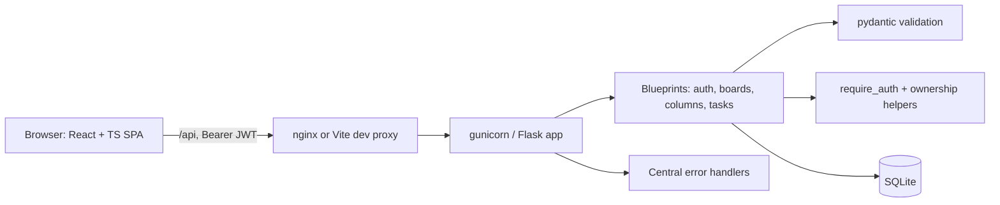
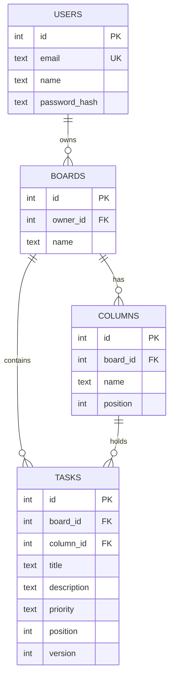

# TaskFlow

A full-stack Kanban / project-management app: a Flask + SQLite REST API with hand-rolled JWT auth and optimistic locking, and a React + TypeScript single-page client with drag-and-drop boards.

Author: Chintada Rizvi Kumari. License: MIT.

## Problem statement

Small teams and individuals need a lightweight board to track work across stages (To Do, In Progress, Done). The interesting engineering problems are the ones every collaborative tool hits: authenticating users safely, making sure one user cannot see another's data, and not silently losing edits when two clients change the same task. TaskFlow is a compact, dependency-light implementation of those concerns end to end.

## Features

- Registration and login; PBKDF2-HMAC-SHA256 password hashing; HS256 JWTs implemented with the standard library (`hmac`, `hashlib`).
- Boards, columns and tasks with full CRUD; each new board gets default columns.
- Ownership checks on every resource; another user's resources return 404.
- Server-side pagination (`page`, `page_size`, capped at 100), filtering (`column_id`, `priority`) and substring search (`q`, LIKE wildcards escaped).
- Optimistic locking on tasks through a `version` column; stale writes get `409 version_conflict` with the current server copy in the body.
- Strict input validation (pydantic, unknown fields rejected) and one JSON error envelope for every failure.
- React client: typed API client, auth context, HTML5 drag-and-drop between and within columns, optimistic updates with rollback, debounced type-ahead search with request cancellation, loading and error states.

## Architecture



| Component | Location | Responsibility |
|---|---|---|
| App factory | `backend/app/__init__.py` | Builds the Flask app, registers blueprints, CORS, health check |
| Config | `backend/app/config.py` | Environment-driven settings (secret, DB path, JWT TTL, PBKDF2 iterations) |
| DB layer | `backend/app/db.py`, `schema.sql` | Per-request connection, `BEGIN IMMEDIATE` transactions, schema |
| Security | `backend/app/security.py` | JWT encode/decode (algorithm pinned), password hashing |
| Auth decorator | `backend/app/auth.py` | Bearer token verification, sets `g.user_id` |
| Schemas | `backend/app/schemas.py` | Request validation models |
| Errors | `backend/app/errors.py` | `ApiError`, error envelope, global handlers |
| Routes | `backend/app/routes/` | Blueprints and ownership helpers |
| API client | `frontend/src/api/` | Typed fetch wrapper, `ApiError`, DTO types |
| Auth context | `frontend/src/context/AuthContext.tsx` | Token/user state, login/register/logout |
| Board state | `frontend/src/lib/boardState.ts`, `hooks/useBoardData.ts` | Pure move logic, optimistic update and rollback |
| UI | `frontend/src/components/` | Board list, board view, columns, cards, search, login |



## API reference

All routes are under `/api`. Everything except register, login and health requires `Authorization: Bearer <token>`.

| Method | Path | Description |
|---|---|---|
| GET | `/health` | Liveness check |
| POST | `/auth/register` | Create account; returns `{user, token}` (201) |
| POST | `/auth/login` | Returns `{user, token}` |
| GET | `/auth/me` | Current user |
| GET | `/boards` | Paginated own boards; `page`, `page_size`, `q` |
| POST | `/boards` | Create board with default columns |
| GET / PATCH / DELETE | `/boards/{id}` | Read (with columns), rename, delete (cascades) |
| POST | `/boards/{id}/columns` | Add column |
| GET | `/boards/{id}/tasks` | Paginated tasks; `q`, `column_id`, `priority`, `page`, `page_size` |
| PATCH / DELETE | `/columns/{id}` | Rename; delete (cascades tasks) |
| POST | `/columns/{id}/tasks` | Create task |
| GET / PATCH / DELETE | `/tasks/{id}` | Read; update or move (requires `version`); delete |

Task `PATCH` body: `{"version": n, "title"?, "description"?, "priority"?, "column_id"?, "position"?}`. A stale `version` returns:

```json
{"error": {"code": "version_conflict", "message": "Task was modified by someone else",
           "details": {"current_version": 3, "current": {"id": 1, "...": "..."}}}}
```

Error envelope: `{"error": {"code", "message", "details"?}}`. Statuses used: 400 non-object body, 401 auth, 404 missing or not owned, 409 duplicate email or version conflict, 422 validation.

## Design decisions and trade-offs

- **Optimistic locking over pessimistic locks.** Edits are short and conflicts rare, so a `version` column checked inside a `BEGIN IMMEDIATE` transaction is enough, with no lock state to expire. The cost is that a losing client must refetch and retry; the 409 body returns the current copy to make that cheap, and the UI rolls back and reloads.
- **Positions are contiguous integers, renumbered on move.** Simple to reason about and to mirror in the client's pure `moveTaskLocal`. Each move rewrites rows in the affected columns (O(n) per column), which is fine at board scale; fractional or linked-list ordering would scale better.
- **Hand-rolled JWT (stdlib).** Keeps dependencies minimal and makes the mechanics explicit: algorithm pinned to HS256 (rejects `alg: none`), constant-time signature compare, mandatory `exp`. In production a vetted library is the safer default; this is a deliberate learning/portfolio choice.
- **JWT trade-offs.** Stateless and easy to scale, but tokens cannot be revoked before expiry (short 1h TTL by default), there is no refresh flow, and the client stores the token in `localStorage`, which is exposed to XSS. HttpOnly cookies plus CSRF protection would be stronger.
- **SQLite.** Zero-ops and transactional, but a single writer; the Docker image runs one gunicorn worker with threads. Moving to Postgres would be the next step for real concurrency.
- **404 for foreign resources** rather than 403, so existence of other users' data is not leaked. Login returns one error for unknown user and bad password.
- **Search disables drag-and-drop in the UI**, because positions are board-wide and reordering a filtered subset would be ambiguous.
- **No rate limiting, email verification, or password reset** are implemented.

## How to run

### Local

```bash
# backend
cd backend
python -m venv .venv && source .venv/bin/activate
pip install -r requirements-dev.txt
TASKFLOW_SECRET=change-me python wsgi.py        # http://localhost:5000

# frontend (separate terminal)
cd frontend
npm install
npm run dev                                       # http://localhost:5173, proxies /api to :5000
```

Backend settings (env): `TASKFLOW_SECRET`, `TASKFLOW_DB`, `TASKFLOW_JWT_TTL`, `TASKFLOW_PBKDF2_ITERATIONS`, `TASKFLOW_CORS_ORIGIN`.

### Docker

```bash
TASKFLOW_SECRET=$(openssl rand -hex 32) docker compose up --build
# app at http://localhost:8080 (nginx serves the SPA and proxies /api to the backend)
```

### Tests

```bash
cd backend && python -m pytest -q     # backend
cd frontend && npm test               # frontend (vitest)
```

CI (`.github/workflows/ci.yml`) runs backend pytest, then frontend typecheck, tests and build.

## Test results

Real output from this environment (Python 3.13, Flask, pydantic, pytest 9.1.1):

```
$ cd backend && python -m pytest -q
.............................................                            [100%]
45 passed in 0.84s
```

Test functions per file: auth 9, boards/columns 9, security 9 (one is parametrized into 4 cases), tasks 15 (plus the parametrization, 45 collected cases in total).

## Verification status

- **Backend: run and passing here.** The full pytest suite (45 tests) was executed in this environment and passed. A smoke run through the Flask test client (register, create board, create task, move it, trigger a 409 with a stale version, search, unauthenticated 401) also behaved as expected.
- **Frontend: written but NOT built, type-checked, or tested here.** This environment has no network, so `npm install`, `tsc`, `vite build` and `vitest` were never run. The TypeScript was reviewed by inspection only; expect that a first real `npm run typecheck` may surface small errors. The vitest files exist but have not been executed.
- **Docker and GitHub Actions** files were written but not executed here.
- No performance measurements were taken; none are claimed.
- `package.json` versions are pinned by hand and there is no lockfile; generate one with `npm install` on first run.
